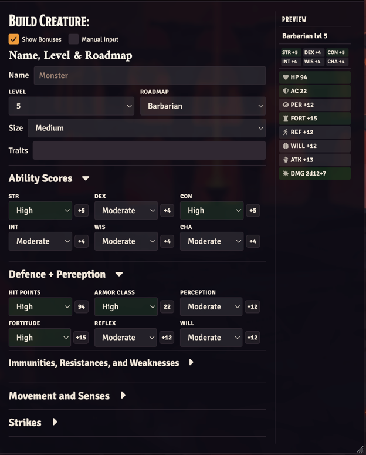
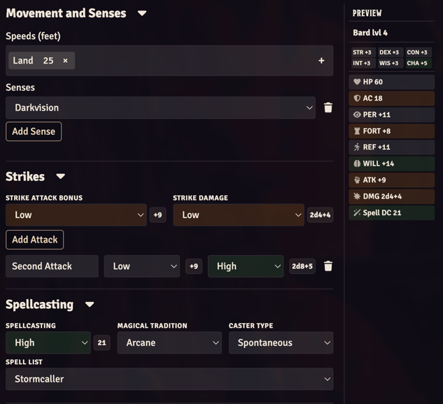
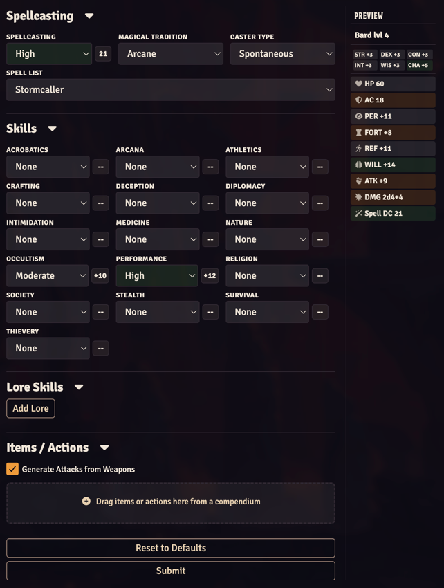
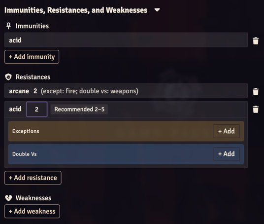
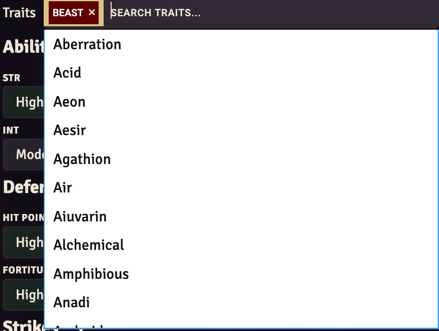
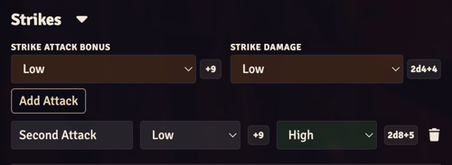
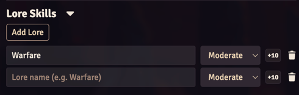
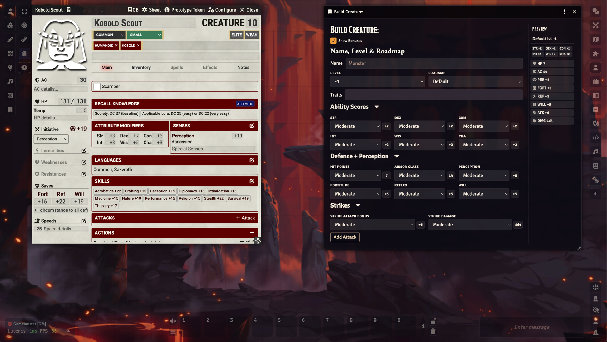

   

# Foundry VTT PF2e Creature Builder

This module was inspired by [pf2e-monster-maker](https://github.com/mikolajg-tt/pf2e-monster-maker). Thanks to the creator **mikolajg-tt** for the solid foundation and great work on the original module.
Current version is a rework of the original idea.

**Install:** `https://github.com/dosexe/pf2e-creature-builder/releases/latest/download/module.json`

A Foundry VTT module for the Pathfinder 2E and Starfinder 2E systems that lets you create NPCs from scratch or from an existing creature, using values from the [PF2E Building Creatures Guide](https://2e.aonprd.com/Rules.aspx?ID=995) and [SF2E Building Creatures Guide](https://2e.aonsrd.com/rules/989-building-creatures). 

### Key Features

- Support for all official roadmaps from the [Pathfinder 2e rules](https://2e.aonprd.com/Rules.aspx?ID=2919) and [Starfinder 2e rules](https://2e.aonsrd.com/rules/1034-building-npcs)
- Build from an existing creature — inherits attributes, skills, traits, spellcasting, strikes, immunities, resistances, weaknesses, and the portrait and token images
- Lore skills, traits, and full spellcasting support
- Support for themed spell lists on Pathfinder 2e
- Custom roadmaps [BETA] (see [ROADMAPS.md](ROADMAPS.md))
- Live preview, drag-and-drop of items and color-coded stats
- Manual Input for the bonus badges, including a damage editor for strikes
- Immunities, resistances, and weaknesses, with a recommended range for the creature level

## Starfinder 2e

The same module runs on the Starfinder Second Edition system (`sf2e`) 1.0.0 or newer. Current Starfinder releases need Foundry 14.361 or newer, which is that system's own minimum.

- Creature-role roadmaps are shared: Brute, Magical Striker, Skirmisher, Sniper, Soldier, and Spellcaster.
- Class roadmaps are Envoy, Mystic, Operative, Solarian, Soldier (Class), and Witchwarper.
- Skills add Computers and Piloting. A custom roadmap can set `computers` and `piloting` next to the other skill keys.
- Trait suggestions come from the system that is running. Themed spell lists stay Pathfinder-only, so the spell list picker is hidden. Spells already on a creature are still copied when you build from that creature.

## Getting Started

To use the **Creature Builder**, you can create a blank NPC or start with an existing one.
When starting from an **existing creature**, the new creature will **inherit all data** from the base creature, including:
- Attributes and statistics
- Skills and Lore skills
- Traits
- Spellcasting (if present)
- Strikes
- Immunities, resistances, and weaknesses
- Portrait and token image

Existing strikes are listed under **Strikes** with the attack name and the closest attack-bonus and damage tiers. On submit, each listed attack is copied from the original strike. Traits (including melee or ranged), attack effects, and extra damage such as persistent and splash stay as they were.

If the resulting creature is a **spellcaster of a higher level than the base creature**, the module will automatically grant additional spell slots:
- **Prepared spellcasters** receive spell slots based on the **wizard spellcasting table**, for more info see [Wizard Class](https://2e.aonprd.com/Classes.aspx?ID=39)
- **Spontaneous spellcasters** receive spell slots based on the **sorcerer spellcasting table**, for more info see [Sorcerer Class](https://2e.aonprd.com/Classes.aspx?ID=62)
- For spellcaster it is also possible to choose a specific themed spell list (see [Themed Spell Lists](https://2e.aonprd.com/Rules.aspx?ID=3383)), which will automatically assign spells according to the creature level.

### Accessing the Creature Builder

- **From an NPC sheet:** Click the **Creature Builder** button in the title bar
- **From the Actors sidebar:** Click the **Creature Builder** button in the footer to start from a blank NPC

Inside the builder, you can:
- Select one of the official **roadmaps**, which automatically sets values appropriate for a given monster type
- Or manually create a unique creature by adjusting any of the available drop-down menus
- Add any number of extra attacks in the **Strikes** section

By default:
- All values are set to `moderate`
- The creature level is set to `-1`, meaning the creature has no inherent strengths or weaknesses

If you plan to customize values manually rather than using a roadmap, consult the [PF2e Official Creature Building Guide](https://2e.aonprd.com/Rules.aspx?ID=995) to ensure the creature remains balanced.

Once all values are set, click the **Submit** button. This will generate a new creature and automatically open its sheet. The prototype token uses the name from the form. Its image is the token image chosen above the name.

If you want to start over at any time, click **Reset to Defaults**, which will clear all changes made in the form.

---

## UI

The builder has one layout: a compact stat grid with a live preview sidebar.

### Form Layout

The form is split into two areas:

| Left — Main Form                                                                                  | Right — Live Preview                                                    |
|---------------------------------------------------------------------------------------------------|-------------------------------------------------------------------------|
| Identity, stats, movement, strikes, spellcasting, skills, items, and the submit and reset buttons | A sticky sidebar showing computed stat values that updates in real time |

Ability Scores, Defence + Perception, Movement and Senses, Strikes, Spellcasting, Skills, Lore Skills, and Items / Actions are **collapsible**. Click a section header to expand or collapse it. **Movement and Senses**, **Skills**, and **Lore Skills** start collapsed.

### Stat Grid

Stats are displayed in a grid with abbreviated labels. Each dropdown has a **bonus badge** next to it showing the computed numeric value for the current level and option.

```
STR [Extreme v] +7    DEX [High v] +5    CON [Moderate v] +4
INT [Low v]     +1    WIS [Moderate v] +4 CHA [High v]     +5
```

Use the **Show Bonuses** checkbox at the top of the form to hide or show the bonus badges.

### Portrait and token

Above the name, the form shows the creature portrait. Click the picture or use the file field to choose an image. **Token image** switches the preview and the file field to the prototype token. Switch back with **Portrait**. **Remove** restores the default artwork for the image you are editing.

### Size

**Size** sits with the name and level. The built-in choices are Tiny, Small, Medium, Large, Huge, and Gargantuan. When the running system publishes `CONFIG.PF2E.actorSizes`, that list is used instead. Submit writes the chosen size onto the creature.

### Immunities, Resistances, and Weaknesses

**Defence + Perception** includes **Immunities, Resistances, and Weaknesses**. The section starts open when the creature already has any of them.

Each list has an Add button. The menu lists types from the running system. A type can be added once. Click a row to add exceptions. A resistance can also list types it doubles against. The same type cannot be both an exception and a doubled type. A collapsed row shows those notes after the name.

A resistance or weakness has a number and a recommended range for the current level, from the creature-building table. A new resistance starts at the low end of that range, and a new weakness starts at the high end. Type another number to replace it. Changing the level keeps that number the same distance from the recommended end for the new level.

### Manual Input

**Manual Input** appears next to **Show Bonuses** while bonuses are shown. Turn it on to edit a badge: click it, type a value, then leave the field or press Enter. Escape puts the previous value back. Text that is not a number is ignored, and the previous value stays.

- A modifier accepts `5` or `+5` and is shown as `+5`. Only a leading minus, such as `-2`, is negative.
- Hit Points, Armor Class, and the spell badge stay unsigned. The spell badge is the spell DC, so `25` and `+25` both display as `25`.
- Strike damage opens a small panel with three fields: number of dice, die (`d4`, `d6`, `d8`, `d10`, or `d12`), and damage bonus. The die list shows a dice icon after each size. After you choose one, that icon sits to the left of the die field, and the three fields stay the same width. Apply writes a formula such as `2d6+4`, `2d6-1`, or `1d8` when the bonus is 0. Cancel or Escape leaves the badge unchanged. The panel stays inside the window and closes if the form scrolls.
- Lore skills and extra attacks use the same badges. Lore follows the Acrobatics table. Each extra attack has an attack-bonus badge and a damage badge.

Saving a value moves that row's Extreme, High, Moderate, or other menu to the closest creature-building tier. Submit uses the typed value. If you edited only an attack's bonus or only its damage, the other one still comes from its tier.

Changing the dropdown by hand clears that edit and shows the table value again. Changing the level drops the typed number and uses the detected tier's table value for the new level. A value detected as High becomes the High value at the new level. A roadmap still replaces the stats it sets. Lore skills and extra attacks keep the tier detected from the typed value and use that tier's table value for the current level, the same way a level change does. Typed values and the Manual Input checkbox stay when the form re-renders. Turning **Manual Input** or **Show Bonuses** off clears every edit, and hiding bonuses also hides Manual Input. **Reset to Defaults** clears every edit.

### Strikes

**Strike Attack Bonus** and **Strike Damage** create one Strike from the creature-building table. That Strike is always added, including when attacks are generated from weapons. It is skipped only when the builder was opened on a creature that already has attacks.

**Add Attack** works like Lore: each row is a name plus an attack-bonus tier and a damage tier. Every row is created on submit. A blank name uses the usual Strike label.

Attacks copied from an existing creature use the original strike. The row's tiers decide how the attack bonus, dice count, and damage bonus scale. The die size, traits, melee or ranged, and the rest of the strike stay with the original. A typed damage formula is still applied when the original strike has no primary damage roll.

### Drag-and-Drop Items & Actions

The **Items / Actions** section at the bottom of the form is a drop zone where you can drag items directly from Foundry compendiums, NPCs or other places. Supported item types:

| Category    | Types                                                          |
|-------------|----------------------------------------------------------------|
| Equipment   | Weapons, armor, shields, equipment, treasure, ammo, containers |
| Consumables | Potions, scrolls, wands, and other consumables                 |
| Abilities   | Actions, feats, conditions                                     |
| Spells      | Any spell (linked to the spellcasting entry on submit)         |
| Skills      | Lore items                                                     |

**Deduplication rules:**
- Stackable items (weapons, equipment, consumables, etc.) can be added multiple times
- Unique items (spells, actions, feats, conditions, lore) are deduplicated — dropping the same one again is ignored
- For spells, deduplication also considers the spell level, so the same spell at different levels is allowed

Dropped spells are automatically **linked to the creature's spellcasting entry** when the form is submitted.

**Generate Attacks from Weapons** is on by default. Dropped weapons are still added to the creature, and one strike is generated per weapon name using the same numbers as PF2E's Generate Attack button. The strike links to the dropped weapon on Pathfinder and Starfinder. A fixed attack bonus on the weapon is used when either system stored it. Two copies of the same weapon can both be added to the inventory; they still produce one strike for that name.

### Module Settings

| Setting                         | Default | Description                                           |
|---------------------------------|---------|-------------------------------------------------------|
| **Abbreviate Creature Builder** | Off     | Show "CB" instead of "Creature Builder" on NPC sheets |

---

## Form screenshots

The form scrolls in one window. The live preview stays on the right.

**Name, level, and defense.** Name, level, roadmap, size, and traits are at the top, with **Show Bonuses** and **Manual Input**. Ability scores and Defence + Perception follow. Immunities and movement are collapsed in this view. The preview shows the roadmap, level, and computed bonuses.



**Movement, strikes, and spellcasting.** Speeds and senses come first. Strikes sets the table attack and any extra attacks. Spellcasting sets the spell DC, tradition, caster type, and spell list.



**Skills, lore, and items.** The skill grid, lore skills, and the item drop zone. **Generate Attacks from Weapons** is on. **Reset to Defaults** and **Submit** are at the bottom.



**Immunities, resistances, and weaknesses.** Each group has its own add button. A resistance or weakness shows the recommended range for the creature's level. Click on the row to edit.



**Traits.** Suggestions come from the running system. Pick a trait from the list, or type one of your own.



**Strikes.** The first row is the table strike. **Add Attack** adds a named strike with its own attack bonus and damage.



**Lore.** **Add Lore** adds a named lore skill and a bonus tier.



The builder beside an NPC sheet:


